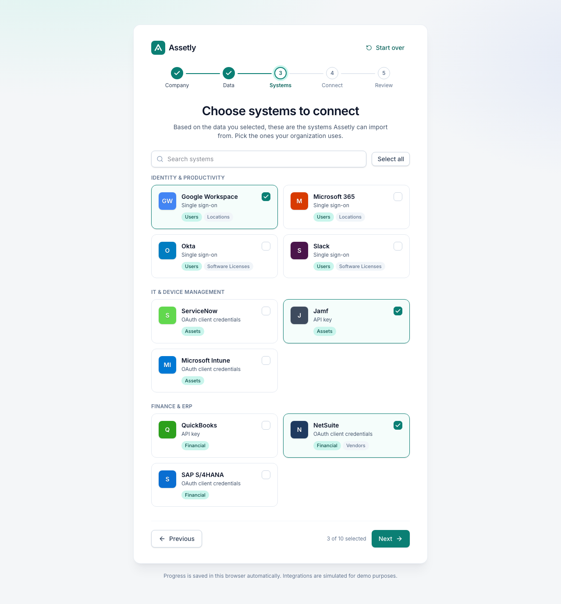
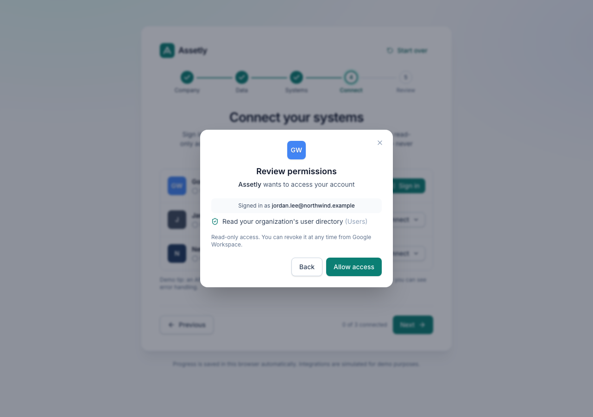
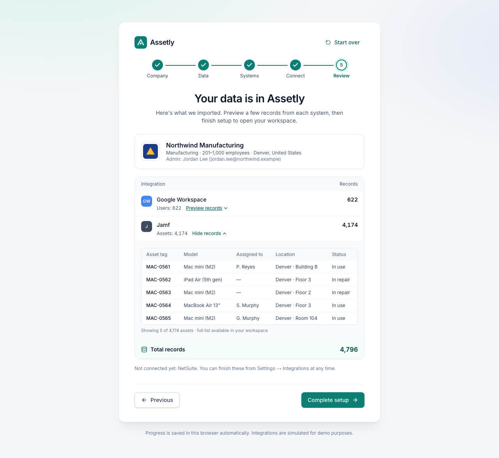
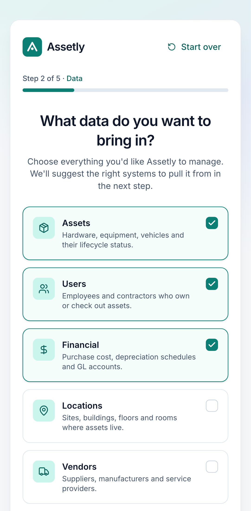
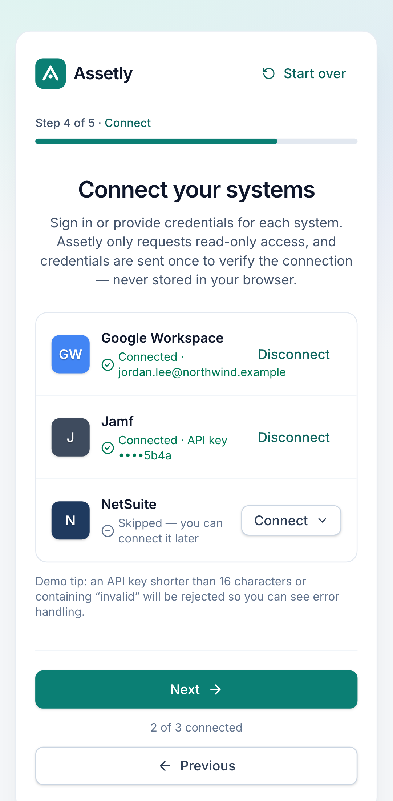
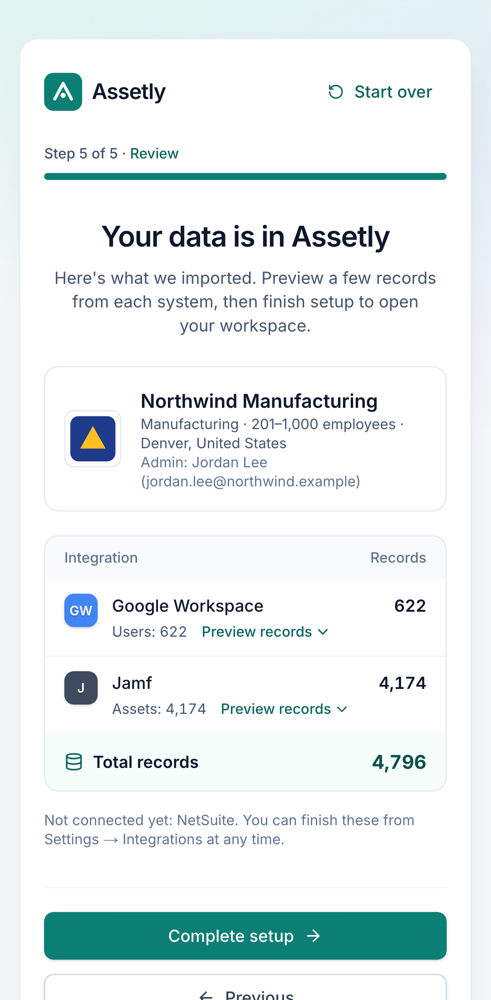
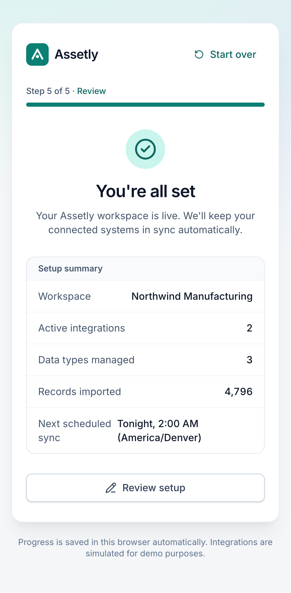

# Assetly — Enterprise Asset Management Onboarding Wizard

A five-step onboarding wizard for **Assetly**, a fictional enterprise asset management (EAM) platform. It walks a new customer through setting up their workspace, choosing what data to import, connecting third-party systems (SSO, API keys, OAuth client credentials), and running the first import.

Built with **Next.js (App Router) · TypeScript · Tailwind CSS · Zustand · React Hook Form + Zod**, tested with **Vitest** and **Playwright**.



## The flow

| # | Step | What happens |
|---|------|--------------|
| 1 | **Company** | Company profile, HQ & time zone, primary admin, fiscal year & currency, and a drag-and-drop **logo upload** (downscaled client-side). Validated with Zod. |
| 2 | **Data** | Pick the data to import: Assets, Users, Financial, Locations, Vendors, Contracts, Software Licenses, IoT/Sensor. |
| 3 | **Systems** | Integrations are **derived from step 2**. Choosing *Financial* shows QuickBooks, NetSuite and SAP, for example. Includes search, grouping, select-all and a warning for uncovered data types. |
| 4 | **Connect** | Each system uses its real-world auth method: a **mock SSO consent dialog** (Google Workspace, Microsoft 365, Okta, Slack, Zoom), an **API key** (Jamf, QuickBooks, Coupa…) or **OAuth client credentials + instance URL** (ServiceNow, NetSuite, SAP…). Shows connected, failed and skipped states and supports retry. |
| 5 | **Review** | Runs the first sync for each connected system in parallel, then shows **record counts per integration** and a grand total. **Preview records** expands sample rows for each data type (assets, users, financial…), personalized with the company's email domain, HQ city and currency → **Complete setup**. |

A step tracker sits at the top of every screen. Clicking **Next** validates the step and saves it. Progress lives in `localStorage`, so a refresh resumes where you left off.

<p>
  
  
</p>
<p>
  
  
  
  
</p>

## Try it

```bash
npm install
npm run dev        # http://localhost:3000
```

The integrations are simulated, so no accounts or secrets are needed. To see error handling, try an API key shorter than 16 characters or one containing `invalid`, or an instance URL that isn't `https://`.

## Architecture

```
src/
├─ app/
│  ├─ page.tsx                          # renders <Wizard />
│  └─ api/integrations/
│     ├─ connect/route.ts               # POST: verify credentials (simulated)
│     └─ import/route.ts                # POST: initial sync → record counts
├─ components/
│  ├─ wizard/   Wizard, StepTracker, StepLayout (shared header/footer/focus)
│  ├─ steps/    CompanyStep, DataTypesStep, SystemsStep, ConnectStep, ReviewStep, CompleteScreen
│  └─ ui/       Button, Field, SelectableCard, LogoUpload, SsoDialog, SystemBadge
└─ lib/
   ├─ catalog.ts        # data types, systems, auth methods, data→system mapping
   ├─ schemas.ts        # Zod schemas shared by forms and API routes
   ├─ store.ts          # Zustand store + persist middleware (localStorage)
   ├─ integrations.ts   # pure simulation logic (unit-tested)
   ├─ recordCounts.ts   # deterministic record-count generator
   ├─ sampleRecords.ts  # seeded, personalized sample rows for the preview
   └─ api.ts            # typed fetch client
```

### Design decisions

- **Simulated backend in route handlers, not the browser.** The client talks to real HTTP endpoints with Zod-validated payloads, realistic latency and proper status codes (400/401/403/404). Swapping in real OAuth or vendor APIs would only change `lib/integrations.ts`, not the UI.
- **The catalog drives the UI.** Steps 3–5 are computed from `catalog.ts`. Adding an integration is one line, and changing step 2 automatically prunes systems, connections and imports that no longer apply (see `saveDataTypes` in the store).
- **Secrets are never persisted.** Credentials are sent once to the connect endpoint. Only the connection status and a masked account label are saved.
- **Deterministic, personalized data.** Record counts come from a hash of system, data type and company size. Sample rows come from a seeded PRNG and are source-aware (Jamf returns Macs and iPads, Intune returns Windows laptops). They use the company's email domain, HQ city and currency, so the data looks realistic and stays stable across screenshots and tests. Changing those step 1 fields clears stale imports.
- **Hydration-safe persistence.** `useHasHydrated()` (via `useSyncExternalStore`) shows a skeleton until `localStorage` loads, which avoids SSR mismatches.
- **No external auth or database.** The project deploys to Vercel with no environment variables.

### Accessibility

- Every input has a label, and errors are linked with `aria-describedby` and announced with `role="alert"`.
- Focus moves to each step's heading on navigation, and the tracker marks the current step with `aria-current="step"`.
- Card checkboxes are real `<input type="checkbox">` elements, so they work with the keyboard and screen readers.
- The SSO dialog uses the native `<dialog>` element for focus trapping and closes with Esc.
- The brand color meets WCAG AA contrast, and animations respect `prefers-reduced-motion`.
- On narrow screens the tracker collapses to "Step N of 5" with a progress bar.

## Testing

```bash
npm test               # Vitest: catalog, schemas, simulation logic, store
npx playwright install chromium   # first time only
npm run e2e            # Playwright: full flow, refresh/resume, start over (desktop + mobile)
SCREENSHOTS=1 npm run e2e         # regenerate docs/screenshots
```

The E2E suite completes the whole wizard. It uploads a logo, connects one system via SSO, fails and then retries an API key, skips one system, checks the import totals, and opens the personalized sample-record previews.

## Deploy

Push to GitHub, import the repo at [vercel.com/new](https://vercel.com/new) and deploy with the defaults. No configuration is required.

## Possible next steps

- Real OAuth for Google and Microsoft (Auth.js) with encrypted token storage
- Server-side persistence (Postgres + Prisma) so an admin can hand off setup to a teammate
- Field mapping between source fields and Assetly asset attributes
- Background sync jobs with progress streaming (SSE)
